<!-- Faceplates in assets/ are generated by tools/build.py from apexaiofficial.com content. Edit them there. -->

<a href="https://apexaiofficial.com"><picture><source media="(max-width: 640px)" srcset="assets/hero-narrow.svg"></picture></a>

  
  
  
  

ApexAi builds guarded products for web data, business communications, autonomous operations, and Telegram commerce, with operator, API, and agent interfaces. **Scrawl** turns web pages into clean, versioned data you own and can cite, with crawling built on Scrapy and extraction on the AI provider you bring. **Communications** is one support inbox for SMS, WhatsApp, and Telegram on your own Twilio, SendGrid, and Telegram accounts, with consent and audit built in. **DevOps** corrects failures in the systems a customer connects, using only actions the customer allows, and proves each fix by observing the system again; its engine is in development and the managed service is planned. **Shop Bot** sells digital products inside Telegram: customers pay in Telegram Stars and receive files, license keys, and memberships once per payment, with every charge on a ledger and a dedicated instance for each merchant; it is built, and a managed white-label service is planned.

Each product owns its rules. A person working in Telegram, an application calling ApexAPI, and an AI agent using ApexMCP all pass the same product policy before anything runs, and all get evidence back. DevOps will be reached the same way, but its ApexAPI and ApexMCP access is planned, not available yet. Shop Bot is used in Telegram only. Nothing is generally released yet: there is no public sign-up, hosted service, or price.

<a href="https://apexaiofficial.com/scrawl"><picture><source media="(max-width: 640px)" srcset="assets/scrawl-narrow.svg">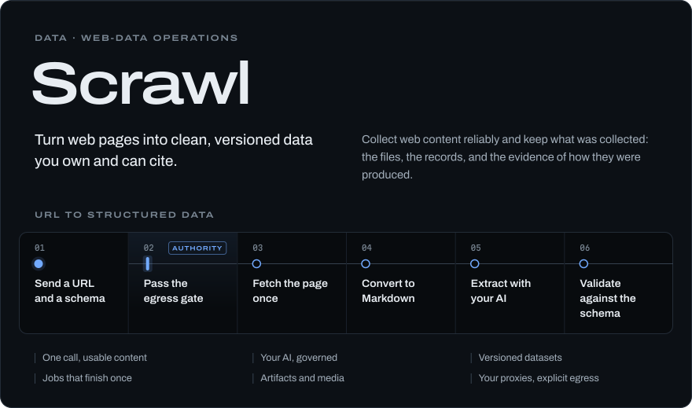</picture></a>

<a href="https://apexaiofficial.com/communications"><picture><source media="(max-width: 640px)" srcset="assets/communications-narrow.svg">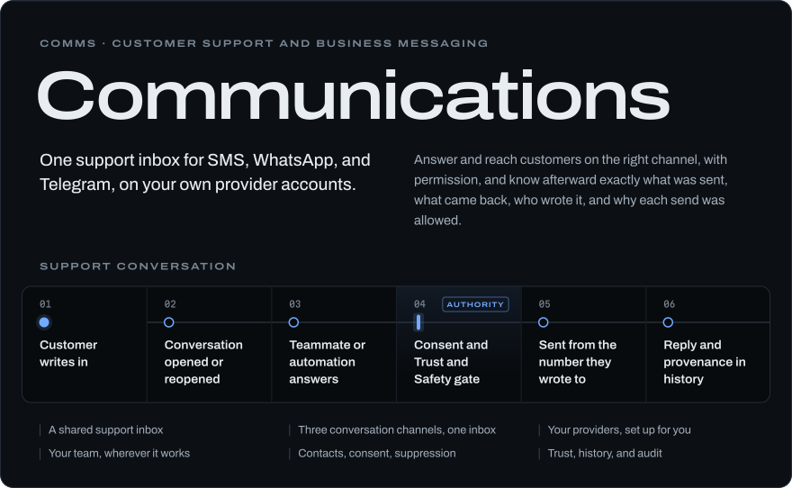</picture></a>

<a href="https://apexaiofficial.com/devops"><picture><source media="(max-width: 640px)" srcset="assets/devops-narrow.svg">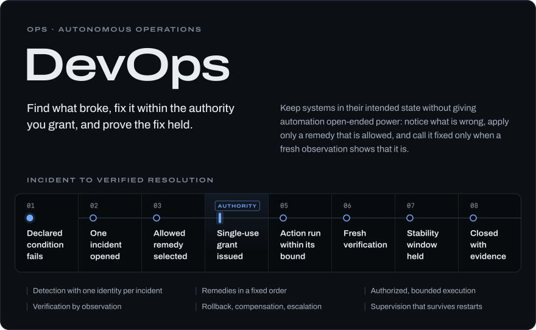</picture></a>

<a href="https://apexaiofficial.com/shop"><picture><source media="(max-width: 640px)" srcset="assets/shop-narrow.svg">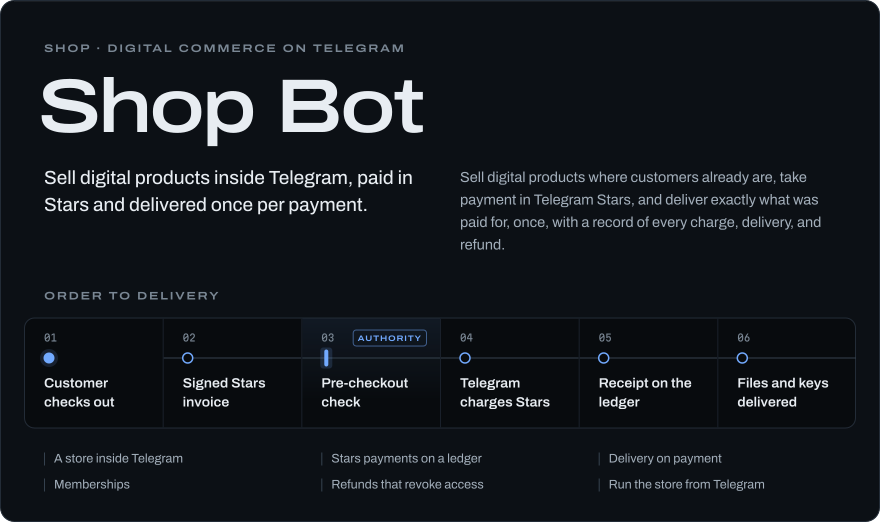</picture></a>

<a href="https://apexaiofficial.com/developers#availability"><picture><source media="(max-width: 640px)" srcset="assets/availability-narrow.svg">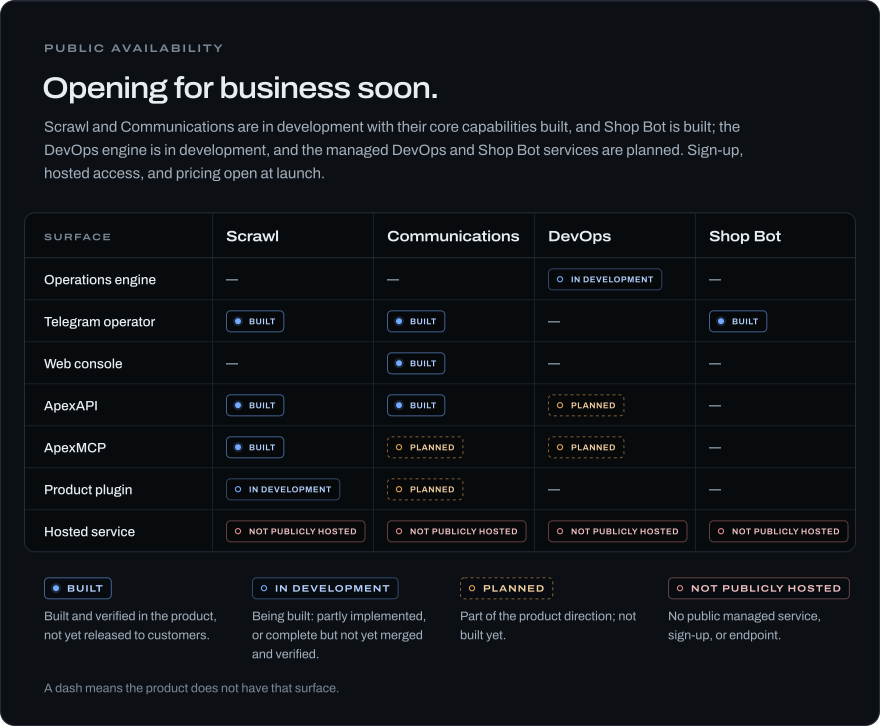</picture></a>

<a href="https://apexaiofficial.com/developers"><picture><source media="(max-width: 640px)" srcset="assets/access-narrow.svg">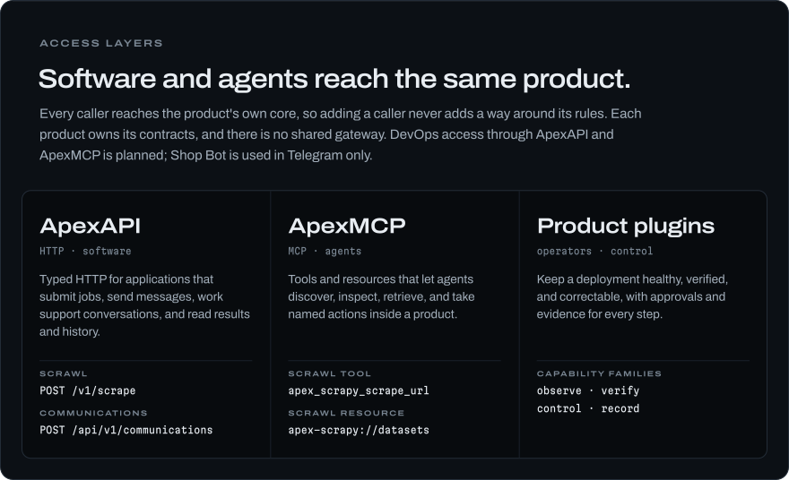</picture></a>

<a href="https://apexaiofficial.com/custom-orders"><picture><source media="(max-width: 640px)" srcset="assets/custom-orders-narrow.svg">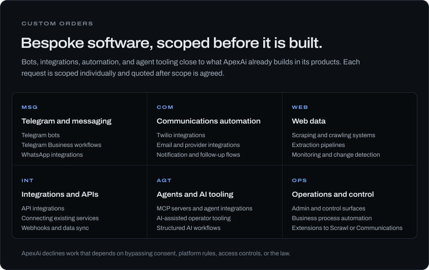</picture></a>

<picture><source media="(max-width: 640px)" srcset="assets/open-source-narrow.svg"></picture>

  <a href="https://github.com/ApexAiOfficial/privacy-chain">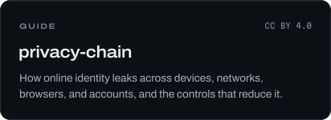</a>
  <a href="https://github.com/ApexAiOfficial/telegram-bot-tutorial">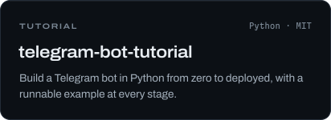</a>
  <a href="https://github.com/ApexAiOfficial/termux-kit">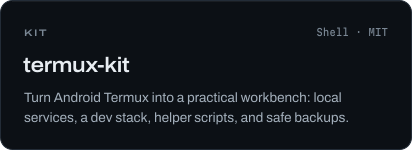</a>
  <a href="https://github.com/ApexAiOfficial/termux-telegram-bot">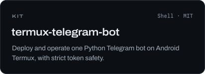</a>
  <a href="https://github.com/ApexAiOfficial/cookie-manager">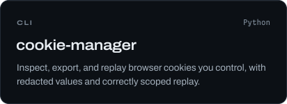</a>
  <a href="https://github.com/ApexAiOfficial?tab=repositories&type=source">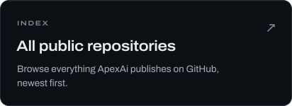</a>

<a href="https://apexaiofficial.com"><picture><source media="(max-width: 640px)" srcset="assets/footer-narrow.svg">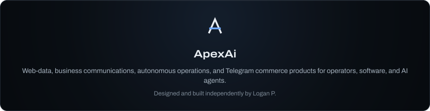</picture></a>

  <a href="https://apexaiofficial.com">apexaiofficial.com</a>
   
  Sales: <a href="mailto:sales@apexaiofficial.com">sales@apexaiofficial.com</a>
   
  Support: <a href="mailto:support@apexaiofficial.com">support@apexaiofficial.com</a>
   
  Direct: <a href="https://t.me/ApexAiAdmin">@ApexAiAdmin</a> on Telegram
   
  On Telegram:
  <a href="https://t.me/ApexAiOfficial">official updates</a> ·
  <a href="https://t.me/ApexAiCentral">community</a>
   
  On Facebook: <a href="https://www.facebook.com/ApexAiOfficial">@ApexAiOfficial</a>

